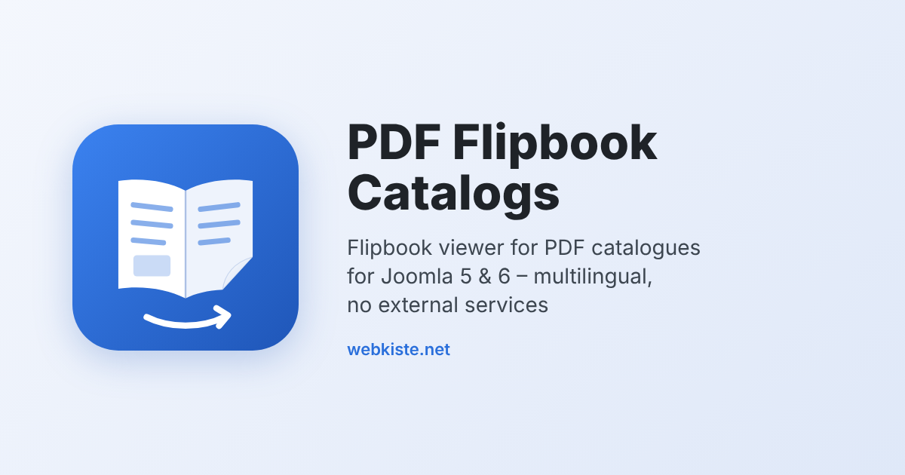

# PDF Flipbook Catalogs for Joomla

A Joomla site module that lists your PDF catalogues per language – with an automatically generated cover thumbnail – and opens them in a built-in **flipbook viewer**.

The viewer is based on [PDF.js](https://mozilla.github.io/pdf.js/) and runs entirely on your own server: **no external services, no CDN, no cookies, no tracking.**

> **Important – designed for multilingual sites:** The module looks for the PDFs in **one subfolder per language** (e.g. `images/flipbooks/de/`, `images/flipbooks/en/`) and shows the PDFs of the current page language. On a **single-language site** you can put the PDFs directly into `images/flipbooks/` – this works as long as there are no language subfolders. See [Folder structure](#folder-structure-and-file-names).
>
> **Wichtig – ausgelegt auf mehrsprachige Seiten:** Das Modul sucht die PDFs in **je einem Unterordner pro Sprache** (z. B. `images/flipbooks/de/`). Bei **einsprachigen Seiten** dürfen die PDFs direkt in `images/flipbooks/` liegen, solange es keine Sprach-Unterordner gibt.

*Deutsche Kurzanleitung weiter unten.*

## Features

- **Flipbook viewer:** double pages with a page-flip effect (cover shown alone), single pages with swipe on smartphones
- Page overview with thumbnails, **full-text search** in the PDF (with text snippets), zoom with drag-to-pan
- Clickable links from the PDF (web links and jumps within the catalogue)
- Fullscreen, PDF download, jump to page, keyboard navigation (← → Home End), direct links to a page (`#page=12`)
- Viewer interface in 10 languages (DE, EN, FR, ES, IT, NL, PL, PT, CS, TR)
- **Multilingual sites:** one subfolder per language, with a fallback language
- Titles are built from the file names, the order is set by a number prefix – no database, no backend list to maintain
- Cover thumbnails are generated automatically (Imagick + Ghostscript) and renewed when a PDF is replaced
- Three layouts: **List** (e.g. sidebar), **Grid** (catalogue page) and **Downloads** (table with size, date, browse and download buttons, optionally all languages)
- **Colour settings:** accent colour, toolbar background, toolbar text and page background; adjustable flip duration
- Per-file settings for a custom title, a description or hiding a file

## Requirements

- Joomla 5.x or 6.x
- PHP 8.1 or newer
- For cover thumbnails: PHP extension **Imagick** with **Ghostscript** on the server (without it the module shows a placeholder instead of a thumbnail)

## Installation

1. Download the latest `mod_pdfflipbook-x.y.z.zip` from the [Releases](https://github.com/KiSte1204/mod_pdfflipbook/releases).
2. Install it in Joomla under *System → Install → Extensions*.
3. Create a new site module of the type *PDF Flipbook Catalogs*, choose a position and publish it.

Updates are offered through the Joomla update system.

## Folder structure and file names

### Multilingual sites (default)

Create a folder (default: `images/flipbooks`) with **one subfolder per language**, named with the two-letter language code of your site languages (`de` for de-DE, `en` for en-GB …):

```
images/flipbooks/
├── de/
│   ├── 10_Hauptkatalog_2026_DE.pdf
│   └── 20_Neuheiten_2026_DE.pdf
└── en/
    ├── 10_Main_Catalogue_2026_EN.pdf
    └── 20_New_Products_2026_EN.pdf
```

From `10_Main_Catalogue_2026_EN.pdf` the module shows **Main Catalogue 2026**:

- `10_` – sort order (not displayed)
- `_EN` – language code (not displayed)
- `_` – becomes a space

If a language folder is missing or empty, the PDFs of the fallback language are shown (default: `en`).

PDFs placed directly in `images/flipbooks/` are **ignored** as soon as at least one language subfolder exists.

### Single-language sites

Put the PDFs directly into the folder – without any language subfolders:

```
images/flipbooks/
├── 10_Main_Catalogue_2026.pdf
└── 20_New_Products_2026.pdf
```

### Nothing is displayed?

If the module finds no PDFs it outputs nothing for visitors. **Administrators who are logged in on the frontend** see a short notice instead, telling which folder was searched. Typical causes:

- The PDFs are in the main folder, but there are also language subfolders → move the PDFs into the matching language folder.
- The language folder has a different name than the site language (e.g. `DE` instead of `de`, or `german`) → use the lower-case two-letter code.
- The module setting *Catalogue folder* points to a different folder.

## Settings

| Tab | Setting | Description |
|---|---|---|
| Module | Catalogue folder | Folder relative to the Joomla root |
| | Languages | *Current language* or *All languages* (e.g. for the Downloads layout) |
| | Fallback language | Used when there are no PDFs for the page language |
| | Intro text, download link, open in | Optional text above the list, PDF download link, new or same tab |
| Title, description & hiding | Settings per file | Custom title, description or hide a file (`en/file.pdf` or `file.pdf`) |
| Flipbook & thumbnail | Viewer address | Leave empty for the built-in viewer |
| | Thumbnail width | Displayed width in px (generated at double resolution) |
| Appearance | Accent colour | Viewer: buttons, highlights, toolbar line. Module: thumbnail border and buttons |
| | Toolbar background / text | Colours of the viewer toolbar |
| | Page background | Background behind the pages |
| | Use accent colour in the module | Off = style the module via your template CSS (`--pfb-accent`, `--pfb-accent-dark`) |
| | Flip duration | 100–3000 ms, default 800 |

## Using the viewer without the module

The viewer can also be embedded directly, e.g. in an article via iframe:

```html
<iframe src="/media/mod_pdfflipbook/viewer/index.html?pdf=/images/flipbooks/en/10_Main_Catalogue_2026_EN.pdf&lang=en&langswitch=0"
        style="width:100%; height:85vh; border:0;" allowfullscreen title="Main Catalogue"></iframe>
```

| Parameter | Meaning |
|---|---|
| `pdf` | Path to the PDF – only files on your own domain |
| `lang` | Interface language (de, en, fr …) |
| `title` | Title in the toolbar (otherwise the PDF title or file name) |
| `cover` | Image shown as cover while the PDF loads |
| `langswitch=0` | Hides the language selector |
| `flip` | Flip duration in ms (100–3000) |
| `accent`, `bar`, `barfg`, `stage` | Colours as hex without `#`, e.g. `accent=e30613` |
| `#page=5` | Start page |

## Tips

- **Large PDFs:** The server should allow *range requests* (default for Apache and Nginx). PDF.js then only loads the parts that are needed, and the first page appears quickly.
- **Links in the PDF** must already be contained in the PDF, e.g. by exporting from InDesign with *Hyperlinks* enabled.
- **New viewer language:** copy a block in `media/mod_pdfflipbook/viewer/lang.js` and translate it. Missing texts fall back to English.

## Deutsche Kurzanleitung

1. ZIP unter *System → Installieren → Erweiterungen* hochladen.
2. Ordner `images/flipbooks/` anlegen, darin **je Sprache einen Unterordner** (`de`, `en` … – Kleinbuchstaben, zweistelliges Sprachkürzel) mit den PDFs. Einsprachige Seiten: PDFs direkt in `images/flipbooks/`, dann aber **ohne** Sprach-Unterordner – sobald ein Sprachordner existiert, werden PDFs im Hauptordner ignoriert.
3. Dateinamen nach dem Muster `10_Hauptkatalog_2026_DE.pdf` vergeben: Die Nummer legt die Reihenfolge fest, das Sprachkürzel wird ausgeblendet, `_` wird zum Leerzeichen.
4. Neues Modul vom Typ *PDF Flipbook Catalogs* anlegen, Position wählen und veröffentlichen.
5. Farben im Reiter *Darstellung* an das eigene Design anpassen.
6. Erscheint nichts: Im Frontend als Administrator anmelden – das Modul zeigt dann einen Hinweis, in welchem Ordner es gesucht hat.

## Support

Questions and bug reports: [GitHub Issues](https://github.com/KiSte1204/mod_pdfflipbook/issues)

## License

- PDF Flipbook Catalogs: © 2026 Stefan Kirchhoff, [webkiste.net](https://www.webkiste.net/) – GNU General Public License version 2 or later, see [LICENSE.txt](LICENSE.txt)
- Bundled [PDF.js](https://github.com/mozilla/pdf.js) 6.2.108: © Mozilla Foundation – Apache License 2.0, see `src/media/viewer/lib/pdfjs/LICENSE`
- Bundled standard fonts of PDF.js: Foxit and Liberation licences, see `src/media/viewer/lib/pdfjs/standard_fonts/`
