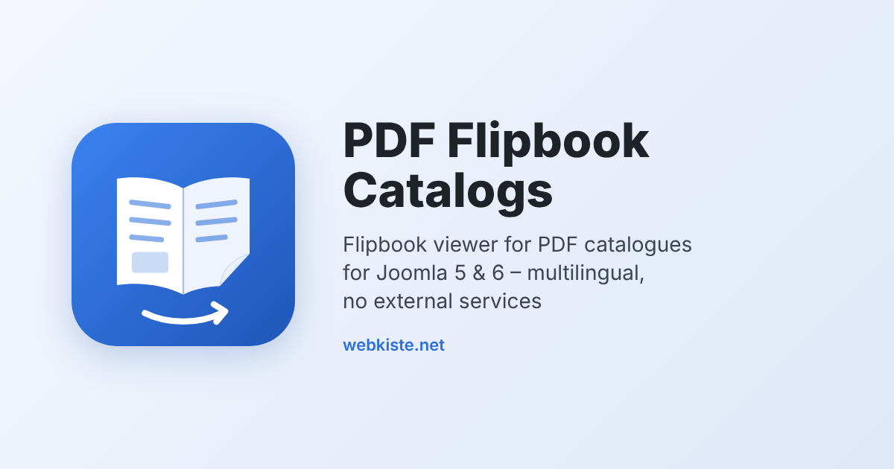
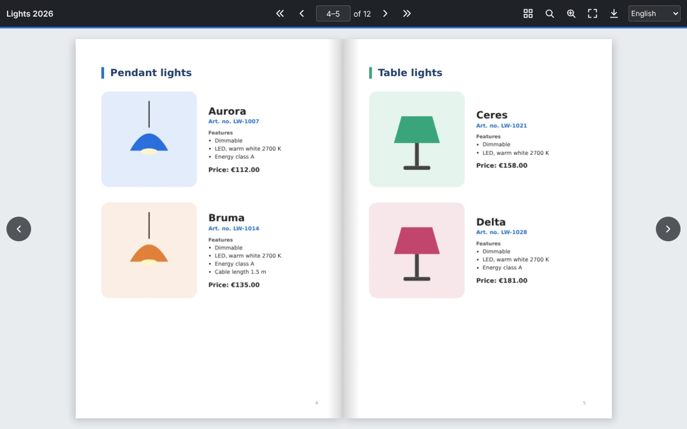
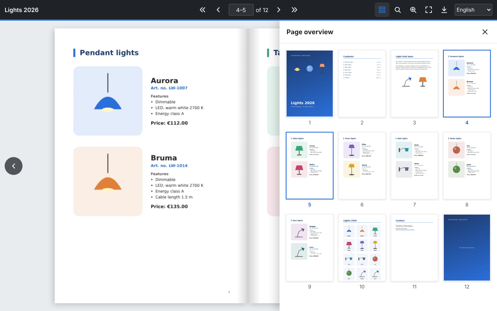
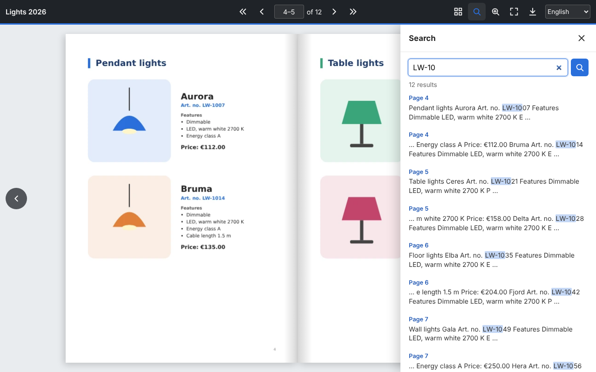
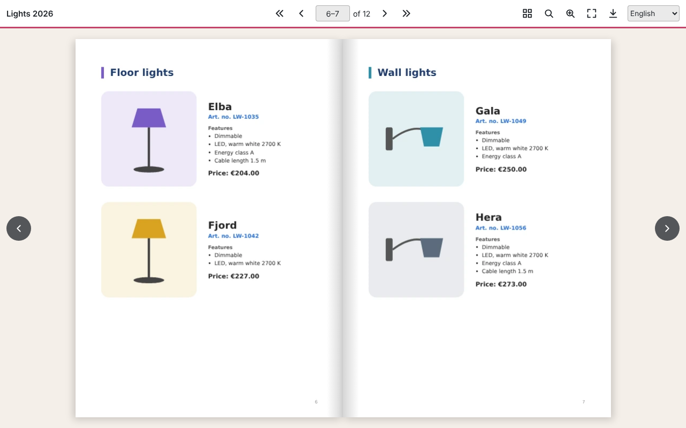
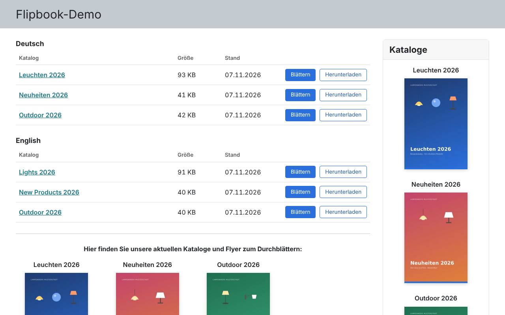
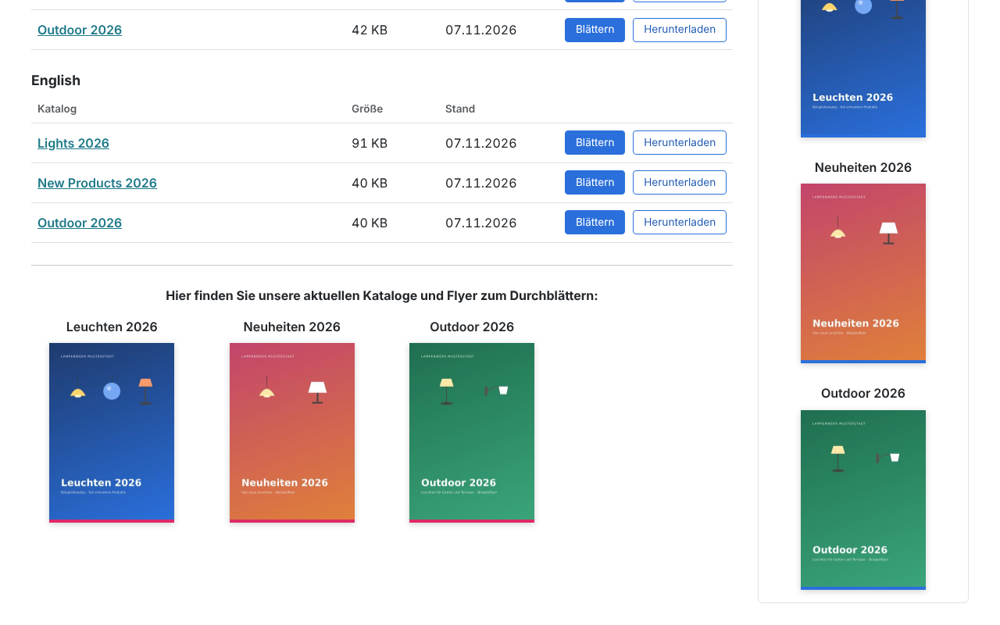

# PDF Flipbook Catalogs for Joomla

A Joomla site module that turns a **folder of PDF files into a ready-made document library**: upload your PDFs via FTP or the Media Manager – the module finds them, builds titles from the file names, generates cover thumbnails, sorts and groups them and opens them in a built-in **flipbook viewer**. Nothing to maintain in the backend.

Perfect for catalogues, brochures, price lists, magazines, newsletters, bulletins, minutes, results lists and yearly archives – on single-language and multilingual sites.

The viewer is based on [PDF.js](https://mozilla.github.io/pdf.js/) and runs entirely on your own server: **no external services, no CDN, no cookies, no tracking.**

> **Folder structure:** PDFs directly in the folder (single-language sites), **one subfolder per language** (`de/`, `en/` – the module shows the files of the current page language) or **subfolders as groups** (`2026/`, `2025/` – the folder name becomes the heading). See [Folder structure](#folder-structure-and-file-names) and [Folders as groups](#folders-as-groups-magazines-bulletins-yearly-archives).
>
> **Ordnerstruktur:** PDFs direkt im Ordner (einsprachige Seiten), **je ein Unterordner pro Sprache** (`de/`, `en/`) oder **Unterordner als Gruppen** (`2026/`, `2025/` – der Ordnername wird zur Überschrift).

*Deutsche Kurzanleitung weiter unten.*

## Features

**Automatic preparation of your PDFs**

- Just drop PDFs into a folder – new files appear automatically, replaced files get a new cover and date
- Titles built from the file names (number prefix and language code removed) – or the **complete file name**, e.g. when it starts with a date
- Cover thumbnails of the first page generated automatically (Imagick + Ghostscript)
- **Groups from subfolders:** every subfolder becomes a section with the folder name as heading (`2026`, `2021-2025` …) – optionally **collapsible**, so long archives stay short
- **Multilingual sites:** one subfolder per language, with a fallback language
- **Sorting:** by file name (ascending/descending), newest first, title A–Z or **manually by drag and drop** – new uploads are marked and placed at the top or bottom
- Per-file settings for a custom title, a description or hiding a file
- Folder inside Joomla or – when Joomla runs in a subfolder – a public folder next to it (`../documents`)

**Layouts**

- **List** (e.g. sidebar) and **Grid** with cover thumbnails
- **Downloads:** table with title, size, date, browse and download buttons – size and date columns can be hidden
- **Colour settings:** accent colour, toolbar background, toolbar text and page background; adjustable flip duration

**Flipbook viewer**

- Double pages with a page-flip effect (cover shown alone), single pages with swipe on smartphones
- Page overview with thumbnails, **full-text search** in the PDF (with text snippets), zoom with drag-to-pan
- Clickable links from the PDF (web links and jumps within the document)
- Fullscreen, PDF download, jump to page, keyboard navigation (← → Home End), direct links to a page (`#page=12`)
- Can also be embedded anywhere via iframe (see [Using the viewer without the module](#using-the-viewer-without-the-module))
- Viewer interface in 10 languages (DE, EN, FR, ES, IT, NL, PL, PT, CS, TR)

**Protected documents** (e.g. price lists for dealers, internal minutes): only visitors with the module's access level can open the PDFs – direct links to the files are blocked

## Screenshots

| | |
|---|---|
|  |  |
|  |  |
|  |  |

The sample catalogues used in the screenshots are fictitious.

## Requirements

- Joomla 5.x or 6.x
- PHP 8.1 or newer
- For cover thumbnails: PHP extension **Imagick** with **Ghostscript** on the server (without it the module shows a placeholder instead of a thumbnail)

## Installation

1. Download the latest `mod_pdfflipbook-x.y.z.zip` from the [Releases](https://github.com/KiSte1204/mod_pdfflipbook/releases).
2. Install it in Joomla under *System → Install → Extensions*.
3. Create a new site module of the type *PDF Flipbook Catalogs*, choose a position and publish it.

Updates are offered through the Joomla update system.

## Folder structure and file names

### Multilingual sites (default)

Create a folder (default: `images/flipbooks`) with **one subfolder per language**, named with the two-letter language code of your site languages (`de` for de-DE, `en` for en-GB …):

```
images/flipbooks/
├── de/
│   ├── 10_Hauptkatalog_2026_DE.pdf
│   └── 20_Neuheiten_2026_DE.pdf
└── en/
    ├── 10_Main_Catalogue_2026_EN.pdf
    └── 20_New_Products_2026_EN.pdf
```

From `10_Main_Catalogue_2026_EN.pdf` the module shows **Main Catalogue 2026**:

- `10_` – sort order (not displayed; optional if you sort manually, see *Order*)
- `_EN` – language code (not displayed)
- `_` – becomes a space

If a language folder is missing or empty, the PDFs of the fallback language are shown (default: `en`).

PDFs placed directly in `images/flipbooks/` are **ignored** as soon as at least one language subfolder exists.

### Single-language sites

Put the PDFs directly into the folder – without any language subfolders:

```
images/flipbooks/
├── 10_Main_Catalogue_2026.pdf
└── 20_New_Products_2026.pdf
```

### Folders as groups (magazines, bulletins, yearly archives)

Set *Subfolders* to **Folders as groups**. Every subfolder becomes a group, the **folder name is the heading**:

```
images/magazine/
├── Statutes.pdf              ← PDFs directly in the folder: shown at the top without heading
├── 2026/
│   ├── 2026_02_magazine.pdf
│   └── 2026_01_magazine.pdf
└── 2021-2025/
    └── 2025_12_magazine.pdf
```

- *Folder order*: name descending (newest year first, default) or ascending.
- *Collapsible groups*: all open, first group open or all collapsed – keeps long archives short on the first page view.
- On multilingual sites the group folders are placed **inside the language folder** (`de/2026/`, `en/2026/`); the language folder of the page (or the fallback language) is used.
- Only one level of subfolders is read. Empty folders and hidden folders are ignored.
- Titles are built from the file names as usual. A leading date such as `2026_05_` is kept in the title; use *Title, description & hiding* for nicer titles.

### PDFs outside the Joomla folder

If Joomla is installed in a subfolder (e.g. `/cms/`) and the PDFs are in another public folder of the same website (e.g. `/documents/magazine/`), enter the folder with `../`: `../documents/magazine`. The folder must be reachable on the same website – folders above the web root are rejected. Not available for protected catalogues (such a folder can be opened directly); use an absolute path outside the web root there.

### Nothing is displayed?

If the module finds no PDFs it outputs nothing for visitors. **Administrators who are logged in on the frontend** see a short notice instead, telling which folder was searched. Typical causes:

- The PDFs are in the main folder, but there are also language subfolders → move the PDFs into the matching language folder.
- The language folder has a different name than the site language (e.g. `DE` instead of `de`, or `german`) → use the lower-case two-letter code.
- The module setting *Catalogue folder* points to a different folder.

### The viewer keeps loading (spinner)?

Since version 1.3.2 the module checks this itself: after the installation and on the frontend (for logged-in administrators) a notice names missing or renamed viewer files.

- Check that the JavaScript files exist in `media/mod_pdfflipbook/viewer/` (`flipbook.js`, `lang.js`) and `media/mod_pdfflipbook/viewer/lib/pdfjs/` (`pdf.min.js`, `pdf.worker.min.js`). Some hosting virus scanners rename them after installation (e.g. to `.j_`) – rename them back and ask your host to whitelist the folder. This may happen again after updates.
- Viewer embedded via iframe in an article: the TinyMCE editor may add an empty `sandbox=""` attribute when saving, which blocks the viewer. Remove it, or insert the iframe with Sourcerer or with the editor switched off.

## Order

In the tab **Order** choose how the catalogues are sorted:

| Sort by | Order |
|---|---|
| File name ascending (number prefix) | Default: by the number at the beginning of the file name (`10_`, `20_` …), then alphabetically |
| File name descending | The other way round (e.g. `2026_…` before `2025_…`) |
| Manual | As arranged in the list below the option – drag the files or use the arrow buttons. **Each language or group folder has its own order.** Renaming files is not necessary |
| Newest first | By the date of the file (last upload first) |
| Title A–Z | Alphabetically by the displayed title |

With **Manual**, files that are uploaded later are marked *new* in the list and shown **at the top** or **at the bottom** (option *New files*) until you save the order again. Deleted files simply disappear from the list. If a language falls back to another language (e.g. `en`), the order of that language folder is used.

## Settings

| Tab | Setting | Description |
|---|---|---|
| Module | Catalogue folder | Folder relative to the Joomla root. If Joomla runs in a subfolder, a public folder next to it is possible too (`../documents/magazine`) |
| | Subfolders | *Language folders* (default) or *Folders as groups* (folder name as heading) |
| | Folder order | Folders as groups: name descending or ascending |
| | Collapsible groups | No / first group open / all collapsed (groups with a heading) |
| | Languages | *Current language* or *All languages* (e.g. for the Downloads layout; language folders only) |
| | Fallback language | Used when there are no PDFs for the page language |
| | Columns size / date | Downloads layout: show or hide the size and date columns |
| | Intro text, download link, open in | Optional text above the list, PDF download link, new or same tab |
| Order | Sort by, new files, manual order | File name ascending/descending, manual (drag and drop per language), newest first or title |
| Title, description & hiding | Title from file name | *Cleaned up* (default: number prefix and language code removed), *complete file name without .pdf* or *with .pdf* |
| Title, description & hiding | Settings per file | Custom title, description or hide a file (`en/file.pdf`, `2026/file.pdf` or `file.pdf`) |
| Flipbook & thumbnail | Viewer address | Leave empty for the built-in viewer |
| | Thumbnail width | Displayed width in px (generated at double resolution) |
| Appearance | Accent colour | Viewer: buttons, highlights, toolbar line. Module: thumbnail border and buttons |
| | Toolbar background / text | Colours of the viewer toolbar |
| | Page background | Background behind the pages |
| | Use accent colour in the module | Off = style the module via your template CSS (`--pfb-accent`, `--pfb-accent-dark`) |
| | Flip duration | 100–3000 ms, default 800 |

## Protected catalogues (e.g. price lists)

For PDFs that only logged-in users may see – price lists, POS material with prices, dealer documents:

1. Put the PDFs into a **separate folder** with the usual language subfolders, e.g. `images/flipbooks-protected/de/`.
2. Create a second module, enter this folder and switch on **Protect files**.
3. Set the module's **Access** (tab *Module*) to *Registered* or a special access level, e.g. *Dealers*.

What happens:

- The module writes a `.htaccess` into the folder that blocks all direct access (Apache, LiteSpeed). A link such as `/images/flipbooks-protected/de/price-list.pdf` returns *403 Forbidden* – even for someone who knows the address.
- The module and the viewer load PDFs and cover thumbnails through `index.php?option=com_ajax&module=pdfflipbook&method=file…`. Joomla first checks whether the visitor has the module's access level; otherwise it answers with *403*. The files are sent with `Cache-Control: private` and `X-Robots-Tag: noindex`.
- Thumbnails of protected catalogues are stored in the hidden subfolder `.thumbs` of the protected folder instead of the public thumbnail folder.
- Logged-in administrators see a notice in the frontend if the folder could not be protected or if the access level is still *Public*.

**nginx and other servers that ignore `.htaccess`:** enter an **absolute path outside the web root** as the folder, e.g. `/home/user/catalogues-protected`. Files there cannot be reached via the web at all; Joomla only delivers them through the access check.

## Using the viewer without the module

The viewer can also be embedded directly, e.g. in an article via iframe:

```html
<iframe src="media/mod_pdfflipbook/viewer/index.html?pdf=images/flipbooks/en/10_Main_Catalogue_2026_EN.pdf&lang=en&langswitch=0"
        style="width:100%; height:85vh; border:0;" allowfullscreen title="Main Catalogue"></iframe>
```

Write both paths **without a leading slash**: Joomla's *System – SEF* plugin adds the Joomla folder to `src`, and the viewer resolves `pdf=images/…` from the Joomla folder. The iframe then also works when Joomla is installed in a subfolder (e.g. `/cms/`) or the site is copied to another folder. Paths with a leading slash (`/images/…`) are read from the domain root as before.

| Parameter | Meaning |
|---|---|
| `pdf` | Path to the PDF – only files on your own domain. Without a leading slash it is relative to the Joomla folder |
| `lang` | Interface language (de, en, fr …) |
| `title` | Title in the toolbar (otherwise the PDF title or file name) |
| `cover` | Image shown as cover while the PDF loads |
| `langswitch=0` | Hides the language selector |
| `flip` | Flip duration in ms (100–3000) |
| `accent`, `bar`, `barfg`, `stage` | Colours as hex without `#`, e.g. `accent=e30613` |
| `#page=5` | Start page |

## Tips

- **Large PDFs:** The server should allow *range requests* (default for Apache and Nginx). PDF.js then only loads the parts that are needed, and the first page appears quickly.
- **Links in the PDF** must already be contained in the PDF, e.g. by exporting from InDesign with *Hyperlinks* enabled.
- **New viewer language:** copy a block in `media/mod_pdfflipbook/viewer/lang.js` and translate it. Missing texts fall back to English.

## Deutsche Kurzanleitung

Das Modul macht aus einem Ordner mit PDF-Dateien automatisch eine fertige Dokumenten-Übersicht: PDFs per FTP oder Medienverwaltung hochladen – Titel, Vorschaubilder, Sortierung und Gruppierung erledigt das Modul, geöffnet wird im eingebauten Blätterkatalog. Geeignet für Kataloge, Preislisten, Zeitschriften, Bulletins, Protokolle, Ranglisten und Jahresarchive.

1. ZIP unter *System → Installieren → Erweiterungen* hochladen.
2. Neues Modul vom Typ *PDF Flipbook Catalogs* anlegen, Position wählen und veröffentlichen. Im Reiter *Modul* den Ordner eintragen (Standard: `images/flipbooks`).
3. **Ordnerstruktur** – je nach Einstellung *Unterordner*:
   - **Einsprachige Seite:** PDFs direkt in den Ordner legen.
   - **Sprachordner** (Standard): je Sprache ein Unterordner (`de`, `en` … – Kleinbuchstaben, Sprachkürzel). Angezeigt werden die PDFs der aktuellen Seitensprache, sonst die der Ersatzsprache. Sobald ein Sprachordner existiert, werden PDFs im Hauptordner ignoriert.
   - **Ordner als Gruppen** (Zeitschriften, Bulletins, Jahresarchive): Jeder Unterordner (z. B. `2026`, `2021-2025`) wird eine eigene Gruppe mit dem Ordnernamen als Überschrift. PDFs direkt im Hauptordner stehen ohne Überschrift oben. Auf mehrsprachigen Seiten liegen die Gruppenordner im Sprachordner (`de/2026/`).
   - Läuft Joomla in einem Unterordner (z. B. `/cms/`), kann auch ein öffentlicher Ordner daneben verwendet werden: `../dokumente/magazin`.
4. **Titel:** Standardmäßig aus dem Dateinamen aufbereitet – `10_Hauptkatalog_2026_DE.pdf` wird zu „Hauptkatalog 2026“ (Nummer vorne und Sprachkürzel entfernt, `_` wird zum Leerzeichen). Steht vorne ein Datum, das sichtbar bleiben soll (z. B. `20260830-rangliste.pdf`), unter *Titel, Beschreibung & Ausblenden* → *Titel aus Dateiname* „Vollständiger Dateiname“ wählen. Dort lassen sich auch einzelne Titel ändern, Beschreibungen ergänzen oder Dateien ausblenden.
5. **Reihenfolge** (Reiter *Reihenfolge*): Dateiname auf- oder absteigend, neueste zuerst, Titel A–Z oder **manuell per Ziehen** – je Sprach- bzw. Gruppenordner eigene Reihenfolge, keine Nummern im Dateinamen nötig. Neu hochgeladene Dateien erscheinen wahlweise oben oder unten. Bei Gruppen außerdem: Reihenfolge der Ordner (neuestes Jahr zuerst oder aufsteigend).
6. **Darstellung:** Layout *Liste*, *Raster* oder *Downloads* (Tabelle mit Größe, Stand, Blättern und Herunterladen – die Spalten *Größe* und *Stand* lassen sich einzeln ausblenden). Gruppen auf Wunsch **aufklappbar** (alle offen, erste offen oder alle zugeklappt). Farben im Reiter *Darstellung* an das eigene Design anpassen.
7. **Geschützte Kataloge** (z. B. Preislisten): eigenen Ordner anlegen (z. B. `images/flipbooks-geschuetzt/de/`), ein zweites Modul mit diesem Ordner erstellen, **„Dateien schützen“** einschalten und die **Zugriffsebene** auf *Registriert* bzw. eine eigene Händlergruppe stellen. Direkte Links auf die PDFs sind dann gesperrt; Joomla liefert die Dateien nur nach Prüfung der Anmeldung aus. Auf nginx-Servern einen Ordner außerhalb des Web-Verzeichnisses mit absolutem Pfad verwenden.
8. **Viewer ohne Modul** (z. B. in einem Beitrag): per iFrame auf `media/mod_pdfflipbook/viewer/index.html?pdf=images/…` einbinden – Pfade **ohne führenden Schrägstrich**, dann funktioniert es auch in Unterordner-Installationen. Im TinyMCE-Editor den Code am besten per Sourcerer einfügen, sonst ergänzt der Editor `sandbox=""` und der Viewer lädt nicht. Details unter [Using the viewer without the module](#using-the-viewer-without-the-module).
9. **Erscheint nichts:** Im Frontend als Administrator anmelden – das Modul zeigt dann einen Hinweis, in welchem Ordner es gesucht hat. Dreht der Viewer endlos: Ab Version 1.3.2 meldet das Modul fehlende oder umbenannte Viewer-Dateien selbst (nach der Installation und im Frontend für Administratoren). Sonst prüfen, ob die `.js`-Dateien unter `media/mod_pdfflipbook/viewer/` vorhanden sind (manche Virenscanner beim Hoster benennen sie um, z. B. in `.j_`).

## Support

Questions and bug reports: [GitHub Issues](https://github.com/KiSte1204/mod_pdfflipbook/issues)

## License

- PDF Flipbook Catalogs: © 2026 Stefan Kirchhoff, [webkiste.net](https://www.webkiste.net/) – GNU General Public License version 2 or later, see [LICENSE.txt](LICENSE.txt)
- Bundled [PDF.js](https://github.com/mozilla/pdf.js) 6.2.108: © Mozilla Foundation – Apache License 2.0, see `src/media/viewer/lib/pdfjs/LICENSE`
- Bundled standard fonts of PDF.js: Foxit and Liberation licences, see `src/media/viewer/lib/pdfjs/standard_fonts/`
